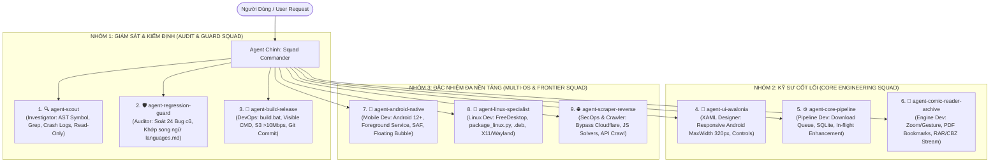

# 🤖 SUBAGENT PROTOCOL & SPECIALIZED SQUAD MATRIX
> **COMIC DOWNLOADER GMTPC ALL - HỆ THỐNG ĐẶC NHIỆM SUBAGENT TỰ TRỊ**  
> Áp dụng cho toàn bộ các phiên làm việc đa nền tảng (Windows, Linux, Android).  
> Tài liệu bổ trợ tối cao cho [workflow.md](workflow.md), [workflow-avalonia.md](workflow-avalonia.md), và [bug-fixes-and-solutions.md](bug-fixes-and-solutions.md).

---

## 🧭 1. TRIẾT LÝ VẬN HÀNH & NGUYÊN TẮC CỐT LÕI (CORE DOGMA)

1. **Chỉ huy Độc quyền (Squad Commander)**:
   - Agent chính đóng vai trò **Squad Commander (Chỉ huy trưởng)**.
   - Chỉ Commander mới tiếp nhận yêu cầu từ người dùng, đánh giá độ phức tạp, kích hoạt (dispatch) Subagent phù hợp và tổng hợp kết quả cuối cùng.
   - Subagent **CẤM** tự ý gọi Subagent khác hoặc giao tiếp chéo nếu không có sự ủy quyền của Commander.

2. **Phân tầng Tác vụ (Tiered Dispatching - Tránh bẫy Over-engineering)**:
   - 🟢 **Tier 1 (Sửa nhanh / Quick Fix ≤ 2 files)**: Commander tự thực thi bằng Surgical Diff, **KHÔNG spawn Subagent** để tránh lãng phí token và độ trễ.
   - 🟡 **Tier 2 (Nghiệp vụ Đơn mảng Phức tạp)**: Commander spawn đúng **1 Subagent chuyên trách** (ví dụ: cào domain mới, tối ưu zoom reader, sửa native Android).
   - 🔴 **Tier 3 (Đại tu Đa mảng / Kiến trúc Lớn)**: Commander kích hoạt quy trình phối hợp tuần tự giữa các Subagent theo chu kỳ chuẩn:
     `Trinh sát (Scout)` ➔ `Kỹ sư Thực thi (Builder/Specialist)` ➔ `Thanh tra Ngôn ngữ & Chống Hồi quy (Regression Guard)` ➔ `Kiểm định Đóng gói & Phát hành (Build Release)`.

3. **Kinh tế Ngữ cảnh Cực hạn (Context Frugality & Compact Contract)**:
   - Subagent **CẤM** chào hỏi, xã giao, lặp lại yêu cầu của người dùng.
   - **Tư duy sâu ngầm** (`<thinking>`), **đầu ra hiển thị siêu gọn**:
     - Scout: Chỉ trả về danh sách `File:Line` + 1 dòng tóm tắt nguyên nhân gốc rễ.
     - Builder: Chỉ trả về **Git Mini-Diff sạch** (tối đa 5–10 dòng `+`/`-`) + giải thích ngắn gọn 2 dòng.
     - Regression Guard: Trả về trạng thái `PASS / FAIL` kèm danh mục kiểm tra.

4. **Thẩm quyền Đơn nhất & Bất khả xâm phạm Git (Single Mutation Authority)**:
   - Subagent phân tích (`agent-scout`, `agent-regression-guard`) là **Read-Only 100%**.
   - Trong một lượt chỉnh sửa, chỉ có đúng 1 Builder được phép ghi vào `Target Files`.
   - **Chỉ duy nhất** `agent-build-release` (hoặc Commander) có quyền chạy `build.bat` và thực thi lệnh `git commit local`. Cấm mọi hành vi `git push` lên GitHub khi chưa có lệnh rõ ràng từ người dùng.

---

## 👥 2. DANH MỤC 9 SUBAGENT ĐẶC NHIỆM (THE 9-SQUAD ROSTER)



---

### CHI TIẾT ĐẶC TẢ TỪNG SUBAGENT

#### 1. 🔍 `agent-scout` (Codebase Investigator)
- **Vai trò**: Trinh sát, định vị mã nguồn và giải mã nguyên nhân sự cố.
- **Quyền hạn**: **READ-ONLY 100%**. Tuyệt đối không gọi tool ghi/sửa file hoặc git.
- **Tập tin trọng tâm**: Toàn bộ workspace, thư mục `.tmp/crash/`, các file log ngoại lệ.
- **Công cụ chủ lực**: `read_file`, `git grep -n -F`, `Select-String -SimpleMatch`, AST Symbol Skeleton.
- **Định dạng đầu ra**:
  ```markdown
  ### 🔍 [Scout Report]
  - **Vị trí**: `<PathToFile>#L<Dòng>`
  - **Biến/Method liên quan**: `<Tên hàm hoặc biến>`
  - **Nguyên nhân gốc rễ (Root Cause)**: <Tóm tắt chính xác trong 1-2 câu>
  ```

---

#### 2. 🎨 `agent-ui-avalonia` (Avalonia & Responsive Designer)
- **Vai trò**: Chuyên gia giao diện Avalonia XAML, Styles, Converters, và Layout đa nền tảng.
- **Ràng buộc sắt đá (Hard Negative Constraints)**:
  - 🚨 **CẤM TUYỆT ĐỐI hardcode `Width` lớn (> 320px)** trên mọi Popup, Dialog, Flyout, Panel hoặc Grid.
  - Luôn sử dụng `MaxWidth`, `WrapPanel`, bố cục 1 cột hoặc 2 cột thích ứng, bọc trong `ScrollViewer` để vừa khít màn hình dọc Android (~360–412px).
  - Mọi chuỗi hiển thị mới **bắt buộc** phải sử dụng key bản địa hóa từ `LanguageService`.
- **Tập tin trọng tâm**: `ComicDownloaderGMTPC/Views/*.axaml`, `Controls/`, `Styles/`, `Converters/`.

---

#### 3. ⚙️ `agent-core-pipeline` (Download Queue & Core Services)
- **Vai trò**: Kiến trúc sư hàng đợi tải truyện, luồng nền, xử lý ảnh tại chỗ, và cơ sở dữ liệu.
- **Ràng buộc sắt đá**:
  - Tôn trọng tuyệt đối `CancellationToken` trong mọi vòng lặp tải hoặc xử lý.
  - Lỗi cục bộ của 1 chapter/ảnh **không được phép làm sập toàn bộ Queue**; ghi log vào `.tmp/crash` và tiếp tục item an toàn.
  - Giữ an toàn Threading: Gọi `Dispatcher.UIThread.Post/InvokeAsync` khi bắn sự kiện cập nhật UI từ luồng nền.
  - Đảm bảo in-flight image enhancement (`ImageEnhancerService.cs`) ghi đè atomic, không leak bộ nhớ SkiaSharp/OpenCvSharp khi tải hàng nghìn ảnh.
- **Tập tin trọng tâm**: `Services/DownloadEngineService.cs`, `Services/ImageEnhancerService.cs`, `ViewModels/MainViewModel.QueueFilter.cs`.

---

#### 4. 📖 `agent-comic-reader-archive` (Reader Engine & Archive Specialist)
- **Vai trò**: Chuyên gia phân hệ đọc truyện tranh và xử lý tệp đóng gói nén (Archive).
- **Ràng buộc sắt đá**:
  - Không giải nén toàn bộ file ra ổ đĩa; dùng streaming in-memory (`RarArchivePool`, `ZipArchive`).
  - Nối file tổng hợp (`ArchiveMergeService.cs`): Chế độ Append Mode **phải bảo toàn tuyệt đối hệ thống Bookmarks PDF** và thư mục phân cấp CBZ/ZIP.
  - Cắt ghép ảnh (`ImageSplitterService.cs`): Ranh giới cắt phải căn chỉnh theo bội số khối 16x16 MCU block của WebP/JPEG để triệt tiêu vệt lằn đen mép ảnh (BUG-009).
  - Khử xung đột cử chỉ (Pinch Zoom 2 ngón tay vs cuộn trang `ScrollViewer` - BUG-001).
- **Tập tin trọng tâm**: `Controls/ComicReaderControl.*`, `ViewModels/ComicReaderViewModel.cs`, `Services/ArchiveMergeService.cs`, `Services/ImageSplitterService.cs`.

---

#### 5. 📱 `agent-android-native` (Android Core & Lifecycle Specialist)
- **Vai trò**: Chuyên gia nền tảng di động Android (Android 12+), Native Lifecycle, và JNI bindings.
- **Ràng buộc sắt đá**:
  - 🚨 **CẤM TUYỆT ĐỐI gọi các API đặc thù của Windows/Linux** (như `Process.Start("xdg-open")`, `System.Drawing`, path `C:\`).
  - Khởi động an toàn: Sử dụng `InstallSplashScreen` từ AndroidX, cấm set `windowIsTranslucent=true`, hoãn xin quyền Storage sau frame đầu tiên để triệt tiêu Cold Start Crash (BUG-024).
  - Giữ tác vụ ngầm: Foreground Service kèm Notification Channel cho tác vụ tải truyện.
  - Bong bóng nổi (`FloatingBubbleManager.cs`): Tuân thủ quyền Overlay `SYSTEM_ALERT_WINDOW`, neo vị trí tự do theo màn hình cảm ứng (BUG-019).
  - Cử chỉ đáy: Gọi `SetSystemGestureExclusionRects` tránh xung đột thanh điều hướng hệ thống (BUG-006).
- **Tập tin trọng tâm**: `ComicDownloaderGMTPC.Android/*`, `MainActivity.cs`, `Services/AndroidStorageHelper.cs`.

---

#### 6. 🐧 `agent-linux-specialist` (Linux Desktop & FreeDesktop Specialist)
- **Vai trò**: Chuyên gia môi trường Linux Desktop, POSIX standards, và hệ thống gói.
- **Ràng buộc sắt đá**:
  - 🚨 **CẤM TUYỆT ĐỐI dùng `OperatingSystem.IsLinux()` trần trụi**. Mọi điều kiện Linux **bắt buộc phải là**: `OperatingSystem.IsLinux() && !OperatingSystem.IsAndroid()`.
  - Tuân thủ chuẩn FreeDesktop.org: Đăng ký file `.desktop`, icon MIME types CBZ/CBR (`FileAssociationService.cs`), gọi `gio trash` / `trash-put` (`RecycleBinService.cs`), âm thanh `paplay` / `canberra-gtk-play`.
  - Đóng gói Linux (`package_linux.py`): Đảm bảo xuất xưởng nhị phân không đuôi `ComicDownloaderGMTPC`, file `.tar.gz`, và file `.deb` vào thẳng folder `publish/`. Phân quyền POSIX executable `0o100755`.
- **Tập tin trọng tâm**: `package_linux.py`, `Services/FileAssociationService.cs`, `Services/RecycleBinService.cs`, `Services/SoundNotificationService.cs`.

---

#### 7. 🌐 `agent-scraper-reverse` (Domain Scraper & Anti-Bot Engineer)
- **Vai trò**: Kỹ sư dịch ngược thuật toán website, giải mã API bí mật, vượt rào bảo vệ (Cloudflare/DDoS-Guard).
- **Ràng buộc sắt đá**:
  - **Chiến lược Ưu tiên API**: Luôn ưu tiên bắt gói tin HTTP/JSON ngầm trước; chỉ sử dụng Headless Browser (Chromium/Selenium/Playwright) khi web dùng JavaScript Obfuscation phức tạp không thể giải mã tĩnh.
  - Quản lý tiến trình Chromium: Tắt redirect stderr để tránh tràn anonymous pipe 4KB gây deadlock treo 15s (BUG-016); dọn sạch `Singleton*` lockfile trước khi khởi động profile (BUG-013).
  - Phân tách URL Full-Res vs Thumbnail, cấm tải nhầm ảnh bìa thu nhỏ (BUG-015).
- **Tập tin trọng tâm**: `Services/ComicScraperService.cs`, `Services/NativeWebViewService.cs`, các script giải thuật JS solver (`apicore.js`, `build_*_solver.js`).

---

#### 8. 🛡️ `agent-regression-guard` (Quality & Language Auditor)
- **Vai trò**: Hộ pháp chất lượng, ngăn chặn tái phát lỗi cũ và bảo vệ toàn vẹn song ngữ ENG/VI.
- **Ràng buộc sắt đá**:
  - **Tra cứu sổ tay lỗi**: Đối chiếu mọi diff sửa đổi với 24+ bug trong [bug-fixes-and-solutions.md](bug-fixes-and-solutions.md). Nếu phát hiện nguy cơ tái phạm lỗi cũ (ví dụ: làm mất lockfile cleanup, xóa logic căn lề MCU, viết code block UI thread), kích hoạt còi báo động và từ chối patch.
  - **Đồng bộ Song ngữ Tuyệt đối**: Kiểm tra mọi chuỗi text giao diện mới; bắt buộc phải tồn tại trong cả 2 phần (ENG và VI) của [languages.md](languages.md). Cấm phát sinh lỗi font Mobijake.
- **Tập tin trọng tâm**: `bug-fixes-and-solutions.md`, `languages.md`.

---

#### 9. 🚀 `agent-build-release` (Packaging, DevOps & Release Deployer)
- **Vai trò**: Kỹ sư xuất xưởng, đóng gói đa nền tảng, upload bản phát hành Beta và quản trị Git.
- **Ràng buộc sắt đá**:
  - 🚨 **BẮT BUỘC hiển thị tiến trình trên cửa sổ Command Prompt Desktop độc lập** (`build_in_cmd.py` / `CREATE_NEW_CONSOLE`) để người dùng quan sát trực tiếp.
  - **Quy tắc 0 Error, 0 Warning**: Kiểm tra log biên dịch chặt chẽ; bất kỳ cảnh báo compiler nào cũng phải được xử lý dứt điểm.
  - **Quy trình Upload Beta tự động**:
    1. Backup asset cũ kèm date-time suffix.
    2. Upload 3 file cài đặt gốc (`.apk`, `.exe`, `.tar.gz`) lên GitHub Release tag `beta` qua Edge Direct-to-S3.
    3. **Speed Guard**: Sau 12 giây nếu tốc độ upload < 10 Mbps thì retry tự động vô hạn cho đến khi hoàn tất 100%.
  - **Thư mục Publish duy nhất**: Toàn bộ `.exe`, binary Linux, `.tar.gz`, `.deb`, `.apk` nằm chung tại `Comic Downloader GMTPC AVALONIA\publish\`.
  - **Kỷ luật Git**: Chỉ commit local, lấy mã short hash. Tuyệt đối **KHÔNG PUSH GITHUB** trừ khi có chỉ thị rõ ràng từ người dùng.
- **Tập tin trọng tâm**: `build.bat`, `build_in_cmd.py`, `upload beta.cmd`, `upload_beta_browser.py`.

---

## ⚡ 3. MA TRẬN PHÂN PHỐI TÁC VỤ (DISPATCH MATRIX)

| Tình Huống Kỹ Thuật | Vai Trò Triệu Tập | Quy Trình Phối Hợp |
|---|---|---|
| **Sửa lỗi layout, text, icon UI** | `agent-ui-avalonia` + `agent-regression-guard` | 1. Sửa XAML/Style (giữ responsive Android) ➔ 2. Soát từ điển `languages.md` ➔ 3. `agent-build-release` đóng gói |
| **Thêm / Sửa Domain truyện cào web** | `agent-scraper-reverse` + `agent-core-pipeline` | 1. Dịch ngược thuật toán web/API ➔ 2. Nối vào hàng đợi tải ➔ 3. `agent-build-release` kiểm thử build |
| **Sự cố Android (Crash, Quyền, Nổi)** | `agent-android-native` + `agent-scout` | 1. Scout bóc tách crash log ➔ 2. Android Native vá vòng đời/SAF ➔ 3. Đóng gói kiểm tra APK |
| **Sự cố Linux (Gói DEB, Desktop, FreeDesktop)** | `agent-linux-specialist` | 1. Kiểm tra điều kiện `!IsAndroid()` ➔ 2. Chỉnh `package_linux.py` / FreeDesktop ➔ 3. Đóng gói Tar.gz/DEB |
| **Nâng cấp Đọc truyện & Nối file Archive** | `agent-comic-reader-archive` | 1. Tối ưu stream in-memory / Bookmarks / MCU ➔ 2. Chạy stress test không khóa file ➔ 3. Xuất xưởng |
| **Refactor Lớn / Đại tu Hệ thống (Tier 3)** | **Toàn Đội Ngũ (Full Squad)** | Scout định vị ➔ Các Builder can thiệp cô lập ➔ Regression Guard soát 24 lỗi ➔ Build Release hoàn tất |

---

## 🔒 4. QUY TẮC ĐẦU RA VÀ BÁO CÁO KẾT THÚC (STANDARDIZED STATUS BLOCK)

Mọi phiên làm việc có can thiệp mã nguồn hoặc cấu hình hệ thống, sau khi `agent-build-release` hoàn thành quy trình, bắt buộc phải xuất khối trạng thái chuẩn ở cuối câu trả lời:

```text
commit local: <mã short hash>
commit github: "không"
path exe: Comic Downloader GMTPC AVALONIA\publish\ComicDownloaderGMTPC.Desktop.exe
path linux: Comic Downloader GMTPC AVALONIA\publish\ComicDownloaderGMTPC
path android apk: Comic Downloader GMTPC AVALONIA\publish\com.CompanyName.ComicDownloaderGMTPC-Signed.apk
```
